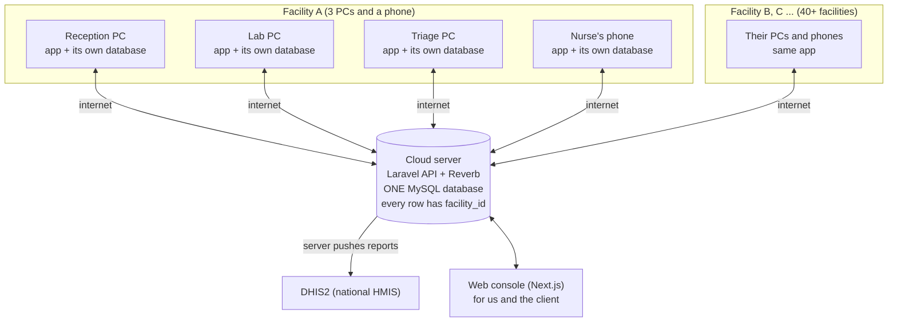
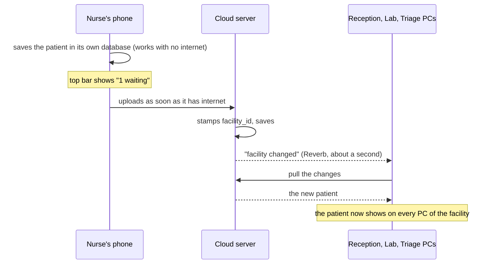

# MRDRS Track A: the new architecture, in plain words

**For the team** (Zed first): how MRDRS will work from the coming field deployment onwards, what stays from today, what
changes, and where each piece lives in the code. Read it in one sitting; the step-by-step build plan and every detailed
decision are in the project workspace (`docs/plan-track-a-multi-facility.md`, `docs/decisions.md`) and each repo's
`docs/`.

*Status: agreed direction, 20 Nov 2026. Parts marked (planned) are being built now.*

---

## 1. In one paragraph

MRDRS keeps being the Flutter app staff already know, still **working offline** on each computer's own database.
What changes is **where it syncs to**: instead of a small server installed at every facility, every PC and phone at
every facility syncs to **one server in the cloud with one database**, where each facility's records are kept apart
by a `facility_id`. A new PC joins with an **enrolment code** (no Laragon, no IP setup), desks see each other's work
**within a second** through Reverb instead of polling, roles **come ready-made**, the app **installs and updates
itself**, and it runs on **Windows and Android**. A small **web console** lets us and the client run 40+ facilities.

## 2. Today vs Track A

| | Today | Track A |
| --- | --- | --- |
| Where data meets | a Laravel + MySQL server on each facility's LAN (Laragon, a fixed IP) | **one cloud server**, one database, all facilities |
| Facilities per server | one | **40+**, kept apart by `facility_id` |
| Installing at a site | Laragon, PHP, MySQL, migrations, IP setup, then the app on each PC | **run the installer, type the enrolment code, sign in** |
| How a PC knows something changed | asks every 2 seconds | the server **tells it** (Reverb); a slow check every few minutes as backup |
| Roles | built by each facility's admin | **ready-made** with their permissions; per-user switches |
| Devices | desktop (Windows) | **Windows and Android**, same app |
| Updates | copy new files | **the app updates itself** from our server |
| Notifications | none | Windows toasts (app in the system tray), Android push |
| Running many facilities | n/a | a **web console** (facilities, devices, releases, DHIS2 log) |

## 3. The big picture

**Every device has its own line to the cloud server, and only that line.** Devices never talk to each other
directly, not even on the same Wi-Fi. The server is where they meet.



Each arrow carries two things: **HTTPS** (the device pushes its unsent changes and pulls the facility's new ones,
with its device token) and a **WebSocket** to Reverb (the server says "something changed in your facility").

### Example: the phone registers a patient



### What each device sees, by network

| The facility's network | Do the PCs see the phone's new patient? |
| --- | --- |
| A Wi-Fi router or hotspot **with internet** (or each device on mobile data) | **Yes, in about 1 to 2 seconds.** |
| A router or hotspot **without internet** (same Wi-Fi, no data) | **Not yet.** Every device keeps working on its own data; the patient appears on the PCs once the internet is back (the phone uploads, the PCs pull). Being on the same Wi-Fi does not help: devices only talk to the cloud. |
| The phone has no internet, the PCs do | When the phone next gets data. |
| Nobody has internet for hours | Each desk works on its own; everything meets up when the internet returns. Nothing is lost. |

**So each facility needs one internet source** for the desks to share work in real time: a router or MiFi with a
data bundle is enough (sync sends small text records, not screens; photos are compressed). The field test measures
the real data use per facility per day.

**If a facility often has no internet during working hours**, a later option is a **local relay built into the app**:
one PC on the facility's Wi-Fi passes changes between the desks while the internet is down, then uploads to the cloud
(no Laragon, no PHP, nothing to install). It is decided after the field visits show how long outages really last.

## 4. A device joins (once)

1. In the console (or a server command) we create the facility. The server makes its **Admin role, its other roles,
   its first admin user** and an **enrolment code**.
2. On the new PC or phone: install the app, type the server address (prefilled) and the **enrolment code**, give the
   device a name ("Reception PC").
3. The server answers with **a token for that device** and the facility it belongs to. The device downloads the
   facility's data (the first pull, needs internet once).
4. Staff sign in **offline** from then on. A lost device is revoked on its own in the console.

## 5. Sync: what stays and what is new

**What stays (Zed's protocol, it works):** ids made on the device; push unsynced rows, then pull; the pull cursor
from the **server's clock** (`server_time`); soft deletes with `.../deleted` tombstones; one `sync/changes` probe;
last write wins by `updated_at`; schema changes **additive only, new fields nullable, server first**.

**What is new:**

- Every request carries the **device token**; the server finds the facility from it and **stamps `facility_id`** on
  every row it saves. The app never sends `facility_id` and its tables don't change for it.
- The server **filters every pull by facility** (one trait on all synced models), so a device only ever sees its
  facility.
- After a push, the server broadcasts **`facility.changed`** on that facility's private channel; the other devices
  sync at once.
- Ids move to **UUID v7** (time-ordered, still UUIDs).
- The app syncs at start, after each save, when the network returns, on a Reverb signal, and every few minutes as a
  safety net.

## 6. What works offline, what needs the internet

| Offline, synced later | Offline, but "Pending" until the server confirms | Needs internet |
| --- | --- | --- |
| patients, visits, triage, notes, diagnoses, lab and imaging requests and results, registers, prescriptions, sign-in | dispensing (shared stock), cash payments and receipts | enrolling a device, the first pull, DHIS2 push, the console |

The top bar always shows the state: **All sent · 3 waiting · Offline · Live**.

## 7. Roles and permissions

Roles come **ready-made from the server** (Facility Admin, In-charge, Reception, Nurse, Clinician, Midwife, Lab,
Radiographer, Pharmacist, Cashier, Insurance, HMIS Officer; to be confirmed in the field). A user has **one role**, a
free-text **title** ("Senior Nursing Officer"), and the facility admin can switch single permissions off or on for
that user. Nobody builds roles in the field. In the app, every check still goes through `getUserPermissions()`.

## 8. Notifications

- **Windows:** closing the window hides the app to the **system tray**; it starts with Windows, stays connected and
  shows **Windows toasts** ("Lab result ready for ..."). It keeps syncing while hidden.
- **Android:** Firebase Cloud Messaging (project `mrdrs-test` for testing).
- **In the app:** a bell with the list.

## 9. Dates and ids (the rules everyone follows)

- Times go to the server in **UTC** (`toUtc().toIso8601String()`); the server stores and compares UTC.
- "Today" and report months are **Kampala days** (UTC+3 all year) through one helper, never the device's zone. The
  app warns when a device's clock or time zone is wrong.
- Ids: **UUID v7**, made on the device.

## 10. Where things live (file structure)

### API (`mrdrsapi`, Laravel 13, PHP 8.4)

```
app/
  Models/
    Facility.php  Device.php  FacilityEnrolmentCode.php  User.php (console)     (planned)
    Patient.php, Visit.php, ... (the 52 synced models, each `use BelongsToFacility`)
    Concerns/BelongsToFacility.php        facility scope + stamping              (planned)
  Http/
    Controllers/Sync/*SyncController.php  the existing sync endpoints
    Controllers/DeviceController.php      enrol, me, sign out                    (planned)
    Controllers/Console/*                 the web console's API                  (planned)
    Middleware/ResolveDevice.php          token -> device -> current facility    (planned)
  Events/FacilityChanged.php              the Reverb signal                      (planned)
  Jobs/PushToDhis2Job.php, LogActivityJob.php                                     (planned)
  Support/CurrentFacility.php, BusinessDate.php                                   (planned)
database/seeders/RolesAndPermissionsSeeder.php   the ready-made roles             (planned)
routes/api.php (sync, devices), routes/channels.php (facility channel)
docs/   sync-and-facilities.md, realtime.md, roles-and-permissions.md, data-rules.md, deployment.md
```

### App (the Flutter repo: Windows + Android)

```
lib/
  core/        (planned: new code goes here)
    api/          one HTTP client, token + app version headers
    auth/         enrolment, device token, offline sign-in
    sync/         the sync engine (today: lib/services/sync_service.dart)
    realtime/     Reverb client, facility channel
    time/         business-day helper (Kampala)
    permissions/  one permission service
    notifications/ tray + toasts (Windows), FCM (Android)
    updates/      in-app updater
  features/<feature>/  data / domain / presentation      (moved here as touched)
  shared/      tables, form sections, empty/loading/error states
  theme/       Material 3 theme, app shell, sync indicator
  data/        drift database (today's tables stay)
  services/    today's sync services (kept, extended in one place)
installer/     Windows installer script (Inno Setup)                  (planned)
AGENTS.md      the rules for anyone (or any AI agent) working in the repo
```

### Console (`mrdrsdash`, Next.js, planned)

```
app/dashboard/  facilities/  devices/  releases/  dhis2-submissions/  audit-trail/  overview
```

## 11. Working together

- **Each person on their own branch** (Farouk: `farouk`); merge by agreement.
- **Server changes ship before the app changes that use them**; new fields nullable.
- **One way of doing each thing**: extend the shared piece (sync engine, permission service, theme), don't add another
  copy.
- **Before a commit:** `dart format`, `flutter analyze` (no new warnings), `flutter test`, and try it on Windows and
  Android against a local API.
- The standards: [../flutter/flutter-engineering-standards-for-agents.md](../flutter/flutter-engineering-standards-for-agents.md)
  and [../flutter/flutter-offline-desktop-and-mobile.md](../flutter/flutter-offline-desktop-and-mobile.md); why
  offline is decided per feature: [../ai-agents/offline-and-online-explaining-to-clients.md](../ai-agents/offline-and-online-explaining-to-clients.md).

## 12. After Track A

**Track B** rebuilds MRDRS around the patient's journey (reception → triage → clinician → lab → pharmacy → billing),
with registers and DHIS2 reports produced from those steps, a web app for every desk and offline where it matters.
Track A's server, facilities, devices and data carry over.
