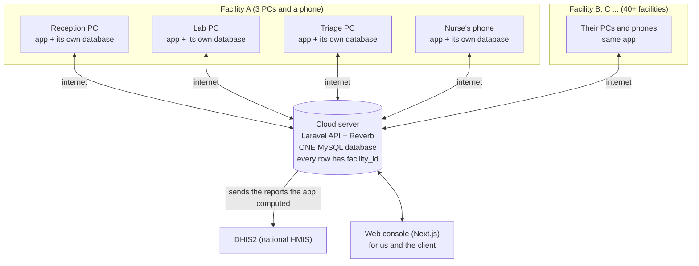
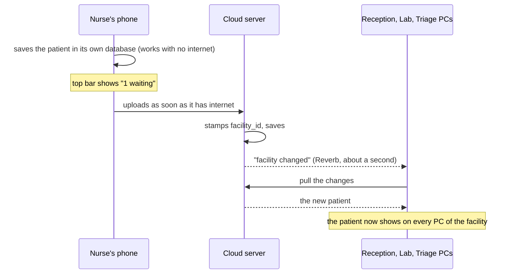
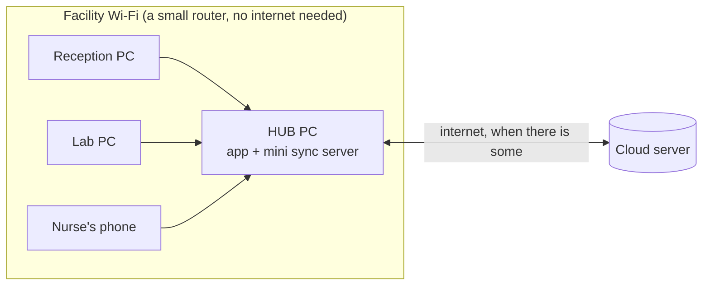

# MRDRS Track A: the new architecture, in plain words

**For the team** (Zed first): how MRDRS will work from the coming field deployment onwards, what stays from today, what
changes, and where each piece lives in the code. Read it in one sitting; the step-by-step build plan and every detailed
decision are in the project workspace (`docs/plan-track-a-multi-facility.md`, `docs/decisions.md`) and each repo's
`docs/`.

*Status: agreed direction 20 Nov 2026; sign-in, facilities on a device, sync and DHIS2 through the server built and
deployed 22 Nov 2026; the first download on the sign-in screen and the encrypted device database built 27 Nov 2026
(app 1.0.11). Sections 4, 4a and 4b describe them as built; parts marked (planned) are still to come. What went wrong
on the way, and the rule now: [../ai-agents/mrdrs-lessons.md](../ai-agents/mrdrs-lessons.md).*

---

## 1. In one paragraph

MRDRS keeps being the Flutter app staff already know, still **working offline** on each computer's own database.
What changes is **where it syncs to**: instead of a small server installed at every facility, every PC and phone at
every facility syncs to **one server in the cloud with one database**, where each facility's records are kept apart
by a `facility_id`. A new PC or phone joins by **signing in with the facility code** (e.g. FAC01) and a staff
account (no Laragon, no IP setup), desks see each other's work
**within a second** through Reverb instead of polling, roles **come ready-made**, the app **installs and updates
itself**, and it runs on **Windows and Android**. A small **web console** lets us and the client run 40+ facilities.

## 2. Today vs Track A

| | Today | Track A |
| --- | --- | --- |
| Where data meets | a Laravel + MySQL server on each facility's LAN (Laragon, a fixed IP) | **one cloud server**, one database, all facilities |
| Facilities per server | one | **40+**, kept apart by `facility_id` |
| Installing at a site | Laragon, PHP, MySQL, migrations, IP setup, then the app on each PC | **run the installer, sign in with the facility code and an account** |
| How a PC knows something changed | asks every 2 seconds | the server **tells it** (Reverb); a slow check every few minutes as backup |
| Roles | built by each facility's admin | **ready-made** with their permissions; per-user switches |
| Devices | desktop (Windows) | **Windows and Android**, same app |
| Updates | copy new files | **the app updates itself** from our server |
| Notifications | none | Windows toasts (app in the system tray), Android push |
| Running many facilities | n/a | a **web console** (facilities, devices, releases, DHIS2 log) |

## 3. The big picture

**Every device has its own line to the cloud server, and only that line.** Devices never talk to each other
directly, not even on the same Wi-Fi. The server is where they meet.



Each arrow carries two things: **HTTPS** (the device pushes its unsent changes and pulls the facility's new ones,
with its device token) and a **WebSocket** to Reverb (the server says "something changed in your facility").

### Example: the phone registers a patient



### What each device sees, by network

| The facility's network | Do the PCs see the phone's new patient? |
| --- | --- |
| A Wi-Fi router or hotspot **with internet** (or each device on mobile data) | **Yes, in about 1 to 2 seconds.** |
| A router or hotspot **without internet** (same Wi-Fi, no data) | **Not yet.** Every device keeps working on its own data; the patient appears on the PCs once the internet is back (the phone uploads, the PCs pull). Being on the same Wi-Fi does not help: devices only talk to the cloud. |
| The phone has no internet, the PCs do | When the phone next gets data. |
| Nobody has internet for hours | Each desk works on its own; everything meets up when the internet returns. Nothing is lost. |

**So each facility needs one internet source** for the desks to share work in real time: a router or MiFi with a
data bundle is enough (sync sends small text records, not screens; photos are compressed). The field test measures
the real data use per facility per day.

**An idea to explore later (not planned): a facility hub, so a facility could work for a week without internet.** One PC is the
facility's hub: the same app on it also runs a small sync server (written in Dart, nothing extra to install). The other
PCs and phones on the facility's Wi-Fi **find it automatically** (it announces itself, so no IP addresses to manage)
and sync with it exactly as with the cloud; the hub sends everything to the cloud whenever it has internet.



It would need a small Wi-Fi router per facility (some phone hotspots stop devices seeing each other) and a 1 to 2 day
test on real hardware first. It is not part of Track A's work. The same idea runs in Kolibri, an offline learning platform used in low-resource
schools.

### DHIS2 reports: the app computes, the server sends

The report figures (033b, 105, 106a...) are **computed in the app, exactly as today**: that code does not move in
Track A. What changes is only the sending: instead of calling the HMIS directly, the app sends the finished report to
our server, which adds the facility's own DHIS2 account and orgUnit, sends it (retrying if the HMIS is slow), and keeps
the HMIS reply for the console. The dataset structure the app needs is fetched through the server too. Because the
figures come from the device's copy of the facility's data, the app **syncs first** and won't compute on stale data.
(Moving the computation to the server, from the day's transactions, is Track B.)

## 4. A device joins: sign in with the facility code (as built, 22 Nov 2026)

**The facility code** (FAC01, FAC02...) is the facility's id on the shared server. One server holds every facility;
the code says which one a person belongs to, so two facilities can each have an "admin" without mixing them up.

1. In the console (or `php artisan facility:create`) we create the facility. The server makes its **code**, its
   ready-made roles and its **first admin account**.
2. On a new PC or phone: install the app, open it, type **facility code + username + password**
   (`POST devices/sign-in`). Nothing else: no server address, no device name, no enrolment code.
3. The server checks the account against **that facility's** users and answers with **a token for this device**
   (Sanctum, one row in `devices`: facility, name, platform, app version, last seen) and the facility's details.
4. The app reopens on **a database file of its own for that facility** (`mrdrs_FAC01_<part of its id>.sqlite`,
   encrypted, section 4b) and **downloads every record of the facility on the sign-in screen** before anyone goes in:
   a percentage, what is coming down ("Now: Patients, page 3") and the size so far. No internet: "Waiting for the
   internet", and it carries on by itself from where it stopped; the app closed halfway reopens on the download. Then
   it signs the person in with what they typed and opens a dashboard with everything already there. This first
   download is the only step that needs internet. (Until 27 Nov people went in after the staff tables while the rest
   came down in the background; someone could then register a patient twice who had not arrived yet.)
5. Staff sign in **offline** on that device against the accounts that came down (bcrypt hashes, never plain text).
   A password changed in the console and not synced yet is checked with the server once and its hash taken. The app
   **stays signed in until Sign out**, so closing it or pressing Back does not sign anyone out.

Extras that came from real use:

- **Several facilities on one device** (a district officer's laptop): each sign-in adds a facility with its own
  token and its own database file; "Facilities on this device" switches between them. Records never mix, because
  they never share a file.
- **Only approved devices** (a switch per facility in the console, off by default): signing in on a new device then
  also asks for an **enrolment code** an admin generated. Testers mixed the two codes up, so the server also accepts
  an enrolment code typed in the facility code box.
- **A lost device** is revoked on its own in the console; the others keep working.
- **Wrong tries** are limited per facility code, username and network address, with one message for every wrong
  part ("the facility code, username or password is wrong"), so it does not reveal which facilities or users exist.

## 4a. Offline, then online again: how sync catches up (as built)

Every record is made **on the device**, with an id made there (a UUID), so it can be saved with no network at all.

- **Every local row carries a tag**: `created`, `updated`, `deleted` (a tombstone, never a hard delete once it has
  synced) or `synced`. Saving offline just writes the row with its tag; nothing waits for the network.
- **When the device is online again** (at start, after a save, when the network returns, on a server signal, and on
  a slow timer as a safety net), sync runs in two steps:
  1. **push**: every row not `synced`, table by table in dependency order (patients before visits before triages);
     the server saves it, stamps the facility from the device token, and answers; the row becomes `synced`;
  2. **pull**: everything changed on the server **since the last cursor**, where the cursor is the **server's clock**
     (`server_time` from the previous pull), never the device's (device clocks are wrong more often than you think).
- **Two devices edited the same record offline**: the newest edit wins (`updated_at`), and the server refuses an
  older write over a newer one (409), so a late push never undoes newer work.
- **The server keeps facilities apart**: it never takes `facility_id` from the app; it stamps it from the token and
  filters every pull by it.
- **After a push the server tells the facility's other devices** (Reverb, a private channel per facility), so they
  pull within a second instead of waiting for the timer.
- **Rows derived on several devices** (a lab test made for a lab fee) take the source row's id, so two offline
  devices filling the same gap write the same row and sync merges them instead of making two.
- **Values only the server keeps** (the facility's name, code, district) are pushed down; if an old PC pushes its own
  copy, the server keeps its value and tombstones the extra row, and the app's lookups take the newest row and never
  crash on two.
- **Schema changes are additive** (new nullable fields, the server first), because old and new app builds sync to
  the same server for a while.

**How a pass runs today (as built, `lib/services/sync_service.dart`):** a timer every 2 seconds (off during the first
download) starts one pass, shared if two callers meet. The pass asks `GET sync/changes?since=<cursor>` which tables
changed (an idle facility answers "nothing" from one indexed column, so an idle device costs one cheap request), then
runs each listed table, or one with unsent rows, in dependency order: push its unsent rows, pull its changes in pages
of 2,000 (`X-Sync-Next` keyset cursor, one database transaction a page, the page reached remembered so a cut pull
resumes). Only a complete pass stamps the new cursor (the server's time minus a 10 s overlap). Photos are not in the
pulls: each record carries a short fingerprint and the photo is fetched when opened. **Every server-side write must
stamp the facility's last write** (model events do it; raw SQL in a command does not, and devices would never see the
rows). **Reverb (as built, 28 Nov):** the app joins its facility's private channel with the device token and syncs
when told, after a local save, and once a minute as a safety net; when the socket is down it polls every 2 s as
before ([../flutter/realtime-reverb-from-flutter.md](../flutter/realtime-reverb-from-flutter.md)).

## 4b. The device database: one encrypted drift file per facility (as built)

- **drift over SQLite**, split by area (`lib/data/tables/<area>.dart`, one DAO per file, modular generation: the old
  single 9,466-line file could not even be generated). Queries live in DAOs, never in screens. Migrations are
  cumulative (`if (from < N)`); before go-live new columns go into the create step.
- **One file per facility on the device**, named after its code and part of its id, so two servers' "FAC01" never
  share a file. A removed facility's file and key are deleted before the next database opens; adding it back starts
  a fresh file.
- **Encrypted** with SQLite3MultipleCiphers (`package:sqlite3` 3.x with `source: sqlite3mc`; the SQLCipher Flutter
  package is end of life). One random 256-bit key per file, kept only in the platform's secure storage (Windows
  DPAPI, Android Keystore); the key is the first statement on every connection. Files from before 1.0.11 are
  converted in place on first open, counted before and after, kept plain if anything differs (retried next start).
  An older app cannot open an encrypted file, so releases never go back. The log says only "DB encryption: on, file
  encrypted", never the key. How: [../flutter/encrypting-the-device-database.md](../flutter/encrypting-the-device-database.md).
- **SQLite runs on the screen's thread** (drift's default `NativeDatabase`): anything big is chunked and deferred.
  The national places list (84,500 rows from a bundled file) loads after the first download, 2,000 rows at a time;
  loaded at sign-in in one go it froze the app, the download's first request timed out, and the app showed "Offline"
  while online and fetched the staff tables twice.
- **Memory:** pulls arrive one page (2,000 rows) at a time and are saved before the next is asked, so a phone never
  holds a whole table; photos are fetched one at a time on demand. Screens that still load a whole table (the audit
  trail, bills) are to be paged (planned).

## 5. Sync: what stays and what is new

**What stays (Zed's protocol, it works):** ids made on the device; push unsynced rows, then pull; the pull cursor
from the **server's clock** (`server_time`); soft deletes with `.../deleted` tombstones; one `sync/changes` probe;
last write wins by `updated_at`; schema changes **additive only, new fields nullable, server first**.

**What is new:**

- Every request carries the **device token**; the server finds the facility from it and **stamps `facility_id`** on
  every row it saves. The app never sends `facility_id` and its tables don't change for it.
- The server **filters every pull by facility** (one trait on all synced models), so a device only ever sees its
  facility.
- After a push, the server broadcasts **`facility.changed`** on that facility's private channel; the other devices
  sync at once.
- Ids move to **UUID v7** (time-ordered, still UUIDs).
- The app syncs at start, after each save, when the network returns, on a Reverb signal, and every few minutes as a
  safety net.

## 6. What works offline, what needs the internet

| Offline, synced later | Offline, but "Pending" until the server confirms | Needs internet |
| --- | --- | --- |
| patients, visits, triage, notes, diagnoses, lab and imaging requests and results, registers, prescriptions, sign-in | dispensing (shared stock), cash payments and receipts | the first sign-in on a device and its first download (on the sign-in screen), DHIS2 push, the console |

The top bar shows the state as a chip: **Synced 10:42 PM · Offline · Sync problem** (a click explains it and lists
any refused rows). A "3 waiting" count is planned.

## 7. Roles and permissions

Roles come **ready-made from the server** (Facility Admin, In-charge, Reception, Nurse, Clinician, Midwife, Lab,
Radiographer, Pharmacist, Cashier, Insurance, HMIS Officer; to be confirmed in the field). A user has **one role**, a
free-text **title** ("Senior Nursing Officer"), and the facility admin can switch single permissions off or on for
that user. Nobody builds roles in the field. In the app, every check still goes through `getUserPermissions()`.

## 8. Notifications

- **Windows:** closing the window hides the app to the **system tray**; it starts with Windows, stays connected and
  shows **Windows toasts** ("Lab result ready for ..."). It keeps syncing while hidden.
- **Android:** Firebase Cloud Messaging (project `mrdrs-test` for testing).
- **In the app:** a bell with the list.

## 9. Dates and ids (the rules everyone follows)

- Times go to the server in **UTC** (`toUtc().toIso8601String()`); the server stores and compares UTC.
- "Today" and report months are **Kampala days** (UTC+3 all year) through one helper, never the device's zone. The
  app warns when a device's clock or time zone is wrong.
- Ids: **UUID v7**, made on the device.

## 10. Where things live (file structure)

### API (`mrdrsapi`, Laravel 13, PHP 8.4)

```
app/
  Models/
    Facility.php  Device.php  FacilityEnrolmentCode.php  User.php (console)     (planned)
    Patient.php, Visit.php, ... (the 52 synced models, each `use BelongsToFacility`)
    Concerns/BelongsToFacility.php        facility scope + stamping              (planned)
  Http/
    Controllers/Sync/*SyncController.php  the existing sync endpoints
    Controllers/DeviceController.php      sign-in (facility code), me, facility, sign out
    Controllers/Console/*                 the web console's API                  (planned)
    Middleware/ResolveDevice.php          token -> device -> current facility    (planned)
  Events/FacilityChanged.php              the Reverb signal                      (planned)
  Jobs/PushToDhis2Job.php, LogActivityJob.php                                     (planned)
  Support/CurrentFacility.php, BusinessDate.php                                   (planned)
database/seeders/RolesAndPermissionsSeeder.php   the ready-made roles             (planned)
routes/api.php (sync, devices), routes/channels.php (facility channel)
docs/   sync-and-facilities.md, realtime.md, roles-and-permissions.md, data-rules.md, deployment.md
```

### App (the Flutter repo: Windows + Android)

```
lib/
  core/        (planned: new code goes here)
    api/          one HTTP client, token + app version headers
    auth/         sign-in with the facility code, device tokens, facilities on this device, offline sign-in
    sync/         sync status chip state, progress of the first download, first_download.dart ("done" check);
                  the engine itself is lib/services/sync_service.dart (+ sync_paging.dart: pages, cursors)
    realtime/     Reverb client, facility channel
    time/         business-day helper (Kampala)
    permissions/  one permission service
    notifications/ tray + toasts (Windows), FCM (Android)
    updates/      in-app updater
  features/<feature>/  data / domain / presentation      (moved here as touched)
  shared/      tables, form sections, empty/loading/error states
  theme/       Material 3 theme, app shell, sync indicator
  data/        drift database: tables/<area>.dart, daos/, drift_database.dart (one encrypted file per facility),
               database_encryption.dart (keys, conversion of plain files)
  screens/login_page.dart  sign-in, the first download with its progress, offline sign-in
  services/    today's sync services (kept, extended in one place)
installer/     Windows installer script (Inno Setup)                  (planned)
AGENTS.md      the rules for anyone (or any AI agent) working in the repo
```

### Console (`mrdrsdash`, Next.js, planned)

```
app/dashboard/  facilities/  devices/  releases/  dhis2-submissions/  audit-trail/  overview
```

## 11. Working together

- **Each person on their own branch** (Farouk: `farouk`); merge by agreement.
- **Server changes ship before the app changes that use them**; new fields nullable.
- **One way of doing each thing**: extend the shared piece (sync engine, permission service, theme), don't add another
  copy.
- **Before a commit:** `dart format`, `flutter analyze` (no new warnings), `flutter test`, and try it on Windows and
  Android against a local API.
- The standards: [../flutter/flutter-engineering-standards-for-agents.md](../flutter/flutter-engineering-standards-for-agents.md)
  and [../flutter/flutter-offline-desktop-and-mobile.md](../flutter/flutter-offline-desktop-and-mobile.md); why
  offline is decided per feature: [../ai-agents/offline-and-online-explaining-to-clients.md](../ai-agents/offline-and-online-explaining-to-clients.md).

## 12. After Track A

**Track B** rebuilds MRDRS around the patient's journey (reception → triage → clinician → lab → pharmacy → billing),
with registers and DHIS2 reports produced from those steps, a web app for every desk and offline where it matters.
Track A's server, facilities, devices and data carry over.
